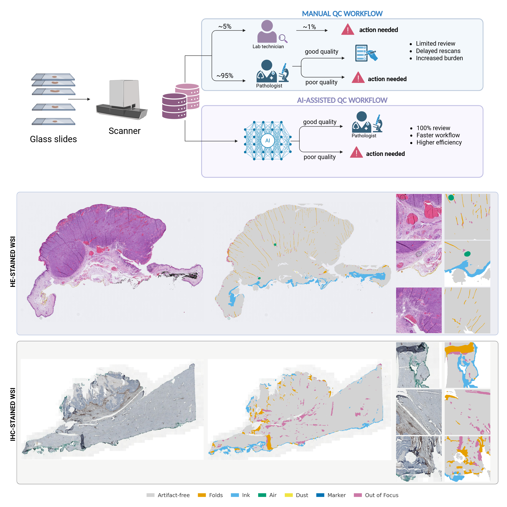

# BigpictureQC: Multi-Stain, Multi-Species Artifact Segmentation for Whole-slide Quality Control

This repository contains the implementation described in the paper **"BigpictureQC: Multi-Stain, Multi-Species Artifact Segmentation for Whole-slide Quality Control"**. It provides an end-to-end inference pipeline for whole-slide image (WSI) quality control: tissue segmentation, artifact segmentation, and per-slide quality scoring.



## ✨ Key features

- **6-class artifact segmentation** — tissue folds, ink, air bubbles, dust, marker, out-of-focus regions
- **Multi-stain and multi-species** — trained and validated across diverse staining protocols and tissue types
- **Per-slide quality scores** — overall quality and artifact scores computed automatically from predicted masks
- **Reproducible Docker deployment** to run inference on new slides with minimal setup
- **Training code included** for model development and fine-tuning

## 🚀 Getting started

### Prerequisites

- [Docker](https://docs.docker.com/get-docker/)
- [NVIDIA Container Toolkit](https://docs.nvidia.com/datacenter/cloud-native/container-toolkit/install-guide.html)

### 1. Download model weights

Model weights will be made available on Zenodo upon publication. Download and extract the weights, then place them in a local folder (e.g., `/path/to/weights`).

### 2. Build the Docker image

```bash
docker build -t bigpictureqc:latest .
```

### 3. Run inference

Mount your slides, output directory, and weights folder:

```bash
docker run --rm --gpus all \
  -v /path/to/slides:/inputs \
  -v /path/to/output:/outputs \
  -v /path/to/weights:/home/user/weights \
  bigpictureqc:latest
```

## 🛠️ Usage

The container entrypoint is `scripts/run_inference.sh`. All flags can be appended after the image name.

### Folder mode (default)

Processes all matching WSIs under `/inputs`:

```bash
docker run --rm --gpus all \
  -v /path/to/slides:/inputs \
  -v /path/to/output:/outputs \
  -v /path/to/weights:/home/user/weights \
  bigpictureqc:latest
```

### Recursive subfolders

If slides are organised in case subfolders (e.g. `slides/case_001/slide.svs`), recursive mode is **auto-detected** when no files match at the top level. You can also set it explicitly:

```bash
docker run --rm --gpus all \
  -v /path/to/cases:/inputs \
  -v /path/to/output:/outputs \
  -v /path/to/weights:/home/user/weights \
  bigpictureqc:latest --recursive
```

### Single-file mode

Pass explicit input and output paths:

```bash
docker run --rm --gpus all \
  -v /path/to/slide.svs:/inputs/slide.svs \
  -v /path/to/output:/outputs \
  -v /path/to/weights:/home/user/weights \
  bigpictureqc:latest \
  /inputs/slide.svs \
  /outputs/tissue/slide_tissue.tif \
  /outputs/artifacts/slide_artifact.tif
```

### DICOM mode

If each case is a subfolder containing DICOM series files, one `.dcm` file is selected per subfolder:

```bash
docker run --rm --gpus all \
  -v /path/to/dicom_cases:/inputs \
  -v /path/to/output:/outputs \
  -v /path/to/weights:/home/user/weights \
  bigpictureqc:latest --dicom
```

### All flags

| Flag | Description |
|---|---|
| `--recursive` | Recursively search subdirectories for slides (auto-enabled if no top-level matches) |
| `--dicom` | Treat each subfolder as one DICOM case; pick one `.dcm` per subfolder |
| `--postprocess` | Apply region filtering and hole filling after artifact inference |
| `--use_tta` | Test-time augmentation for artifact inference |
| `--input_filter REGEX` | Override default file filter (default: `.*\.(tif\|tiff\|svs\|mrxs\|ndpi\|scn\|vms\|vmu\|bif)$`) |

## 📊 Outputs

| Path | Description |
|---|---|
| `/outputs/tissue/{image}_tissue.tif` | Binary tissue mask |
| `/outputs/artifacts/{image}_artifact.tif` | Multi-class artifact mask |
| `/outputs/artifacts/artifact_quality_metrics.yaml` | Per-slide quality metrics |

### Metrics format

```yaml
slide_name:
  slide_id: slide_name
  artifact_proportion: 0.2155
  quality_score: 0.7845
  quality_score_excl_ink: 0.8477
  total_tissue_pixels: 5000000
  artifact_proportions:
    tissue_folds: 0.085
    ink: 0.0632
    air_bubbles: 0.032
    dust: 0.018
    marker: 0.009
    out_of_focus: 0.0083
```

## 🧪 Training

Training configuration is in `config/default.yaml`. To train:

```bash
python src/bigpictureQC/train.py --config config/default.yaml
```

See `config/default.yaml` for the full set of options including augmentation, loss, scheduler, and W&B tracking.

### 🏆 Acknowledgments

This project has received funding from the Innovative Medicines Initiative 2 Joint Undertaking under grant agreement No 945358. This Joint Undertaking receives support from the European Union’s Horizon 2020 research and innovation program and EFPIA ([www.imi.europe.eu](\url{www.imi.europe.eu})).
This work builds upon contributions from the following repositories:
- [pathology-whole-slide-data](https://github.com/DIAGNijmegen/pathology-whole-slide-data) — on-the-fly WSI patch extraction and data loading
- [segmentation-models-pytorch](https://github.com/qubvel-org/segmentation_models.pytorch) — segmentation model architectures and encoders
